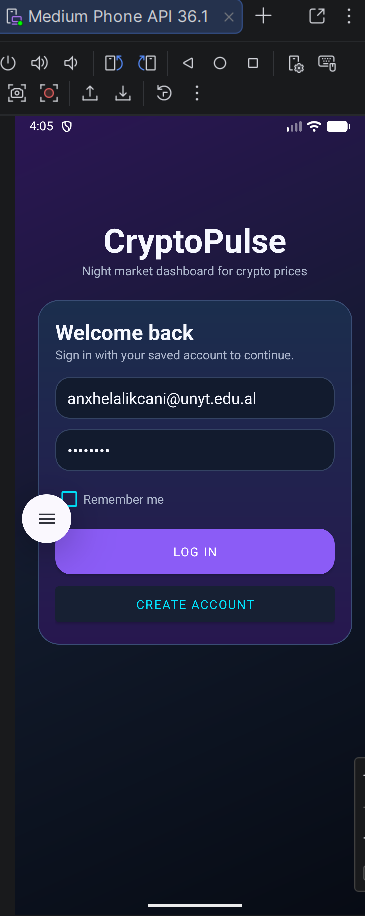
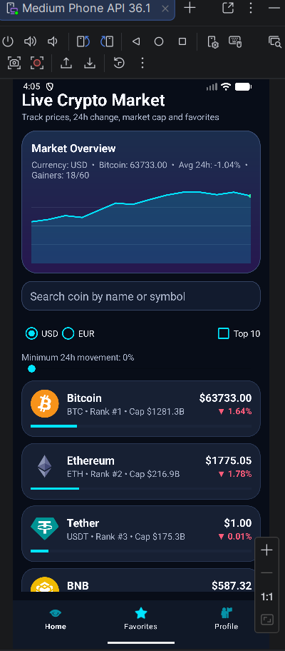
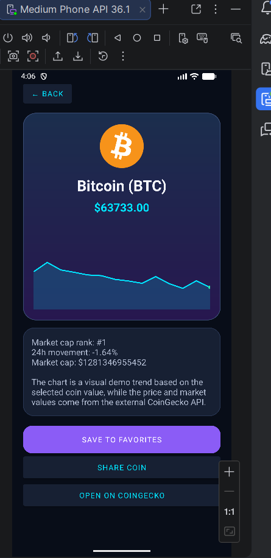
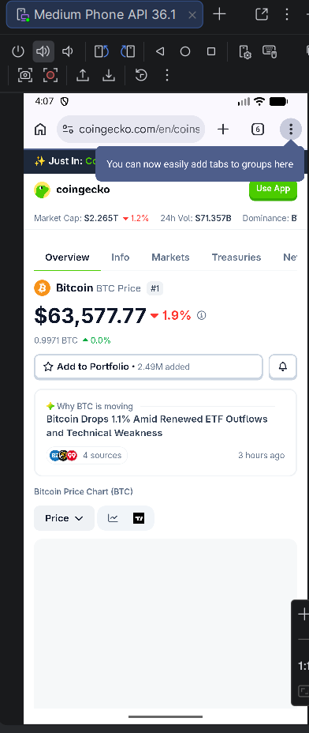

# CryptoPulse Pro

## Mobile Application Development Final Project

**University:** University of New York Tirana
**Course:** Mobile Application Development
**Project Type:** Final Android Application Project
**Application Name:** CryptoPulse Pro
**Platform:** Android
**Programming Language:** Java
**Build Configuration:** Gradle / Groovy DSL

---

## Project Group Members

* Anxhela Likcani


---

## Project Description

CryptoPulse Pro is an Android mobile application created for the Mobile Application Development final project. The application is designed as a cryptocurrency market dashboard where users can create a local account, log in, view live cryptocurrency market data, search and filter coins, open detailed coin information, save favorite cryptocurrencies locally, remove saved favorites, change their password, and use sharing and external navigation features.

The application retrieves live cryptocurrency data from the CoinGecko public API using Retrofit. It displays information such as coin name, symbol, image, current price, market cap rank, market cap, and 24-hour price change. Users can also save selected cryptocurrencies as favorites using a local Room database.

CryptoPulse Pro was designed with a dark/night-mode dashboard interface. The UI includes modern cards, buttons, input fields, radio buttons, checkboxes, a SeekBar, RecyclerView lists, bottom navigation, custom chart views, and a custom app icon.

---

## Application Screenshots

| Login | Dashboard |
|---|---|
|  |  |

| Coin Details | CoinGecko Integration |
|---|---|
|  |  |

---

## Purpose of the Application

The purpose of CryptoPulse Pro is to provide a simple and visually clear way for users to follow cryptocurrency prices, search through market data, and save favorite coins. The project also demonstrates important Android development concepts covered in the Mobile Application Development course, including:

* Activities
* Fragments
* RecyclerView lists
* Room database
* Local user authentication
* Retrofit API communication
* Model classes
* Adapters
* XML layouts
* Implicit intents
* User interface design
* Custom views
* SharedPreferences for user session handling

---

## Application Structure

The project is organized into several packages inside:

```text
app/src/main/java/com/unyt/cryptopulse/
```

The main packages are:

```text
activities
adapters
api
database
fragments
models
views
```

Each package has a specific role in the application.

---

## Implemented Tasks and Requirements

### 1. Multi-Activity Application

CryptoPulse Pro is a multi-activity Android application.

The project includes the following activities:

#### LoginActivity

`LoginActivity` is the first screen shown when the application starts. It allows users to enter an email and password. The app checks the local Room database to verify whether the user exists and whether the entered password is correct.

If the user does not exist, the app displays a message asking the user to create an account. If the password is incorrect, the app displays an incorrect password message.

#### SignupActivity

`SignupActivity` allows the user to create a new local account by entering a name, email, password, and password confirmation. The app validates the input and saves the new user credentials locally in the Room database.

The sign-up screen checks:

* All fields are completed
* Email format is valid
* Password is at least 4 characters
* Password and confirm password match
* Email is not already registered

#### MainActivity

`MainActivity` is the main container of the application. It contains the bottom navigation bar and loads the main fragments of the app. It also checks whether a user session exists before allowing access to the main dashboard.

#### CoinDetailsActivity

`CoinDetailsActivity` opens when the user clicks on a cryptocurrency from the list. It displays detailed information about the selected coin, including image, name, symbol, price, market cap rank, market cap, 24-hour movement, and a chart. It also includes buttons for saving the coin to favorites, sharing it, opening CoinGecko, and going back to the previous screen.

---

### 2. Login and Local Authentication

The project includes a login and sign-up system using a local Room database.

The user account system stores:

```text
Name
Email
Password
```

The app checks whether the user exists during login. If the email exists and the password matches, the user is allowed to access the app.

The application also uses `SharedPreferences` to store the active login session. This allows the app to remember the logged-in user while the session is active.

The authentication system is local to the device. It does not use an online authentication server.

---

### 3. Password Confirmation and Password Change

The project includes password confirmation during sign-up. The user must type the password twice, and the app checks whether both passwords match before creating the account.

The Profile screen also includes a change password feature. To change the password, the user must enter:

```text
Current password
New password
Confirm new password
```

The app checks whether the current password is correct and whether the new password and confirmation match. If the validation succeeds, the password is updated in the local Room database.

---

### 4. Logout

The Profile screen includes a Logout button.

When the user logs out, the app clears the saved user session from `SharedPreferences` and returns the user to `LoginActivity`. The activity stack is cleared so the user cannot press the back button to return to the dashboard after logging out.

---

### 5. Fragments

The application uses fragments inside `MainActivity`.

The project includes three main fragments:

#### HomeFragment

`HomeFragment` displays the live cryptocurrency market. It loads cryptocurrency data from the CoinGecko API and shows the result in a RecyclerView.

It includes:

* Market overview section
* Custom chart view
* Search bar
* USD/EUR currency radio buttons
* Top 10 checkbox
* 24-hour movement SeekBar
* ProgressBar while loading data
* RecyclerView list of coins

#### FavoritesFragment

`FavoritesFragment` displays the cryptocurrencies saved by the user. The saved coins come from the local Room database.

It includes:

* Title and description
* RecyclerView list of saved favorite coins
* Remove from Favorites button for each saved coin

#### ProfileFragment

`ProfileFragment` displays the logged-in user’s name and email. It also includes a change password form, a contact developer email button, project feature information, and a logout button.

---

### 6. Lists and RecyclerView

The project includes lists using RecyclerView.

RecyclerView is used in two main parts of the application:

#### Live Cryptocurrency List

The live cryptocurrency list is shown in `HomeFragment`. It displays market data received from the CoinGecko API.

#### Favorites List

The favorites list is shown in `FavoritesFragment`. It displays coins saved locally in the Room database.

The adapters used are:

```text
CoinAdapter.java
FavoriteAdapter.java
```

The reusable item layouts are:

```text
item_coin.xml
item_favorite_coin.xml
```

Each coin card displays:

* Coin image
* Coin name
* Symbol
* Market rank or saved symbol
* Market cap
* Current price
* 24-hour price change
* Progress indicator

The favorite coin layout also includes a Remove from Favorites button.

---

### 7. Database

The project includes a local database using Room.

The Room database is used for two main purposes:

```text
Saving user accounts
Saving favorite cryptocurrencies
```

The database-related files are:

```text
FavoriteCoin.java
FavoriteDao.java
User.java
UserDao.java
AppDatabase.java
```

#### User.java

This file defines the database entity for a saved user account.

The saved user data includes:

* Name
* Email
* Password

#### UserDao.java

This file defines the database operations for users, including:

* Insert new user
* Find user by email
* Login check by email and password
* Check whether email already exists
* Update password

#### FavoriteCoin.java

This file defines the database entity for a saved favorite coin.

The saved favorite coin data includes:

* Coin ID
* Coin name
* Coin symbol
* Coin image URL
* Coin price
* Coin 24-hour change

#### FavoriteDao.java

This file defines the database operations for favorite coins, including:

* Insert favorite coin
* Delete favorite coin
* Get all favorite coins
* Check whether a coin already exists

#### AppDatabase.java

This file creates and manages the Room database instance.

The database name is:

```text
cryptopulse_db
```

The database includes the following tables:

```text
users
favorites
```

---

### 8. Network Communication

The project includes network communication using Retrofit.

CryptoPulse Pro retrieves external data from the CoinGecko public API. The app presents data from an external server, which satisfies the network communication requirement.

The network-related files are:

```text
CoinGeckoApi.java
RetrofitClient.java
Coin.java
```

The API endpoint used is:

```text
https://api.coingecko.com/api/v3/coins/markets
```

The app requests and displays the following data:

* Coin ID
* Coin symbol
* Coin name
* Coin image
* Current price
* Market cap rank
* Market cap
* 24-hour price change percentage

The app allows the user to switch between USD and EUR prices using radio buttons.

---

### 9. Search and Filters

The Home screen includes a search bar and multiple filters.

#### Search Bar

The user can search for cryptocurrencies by:

```text
Coin name
Coin symbol
```

For example, the user can search for:

```text
bitcoin
btc
ethereum
eth
```

#### Currency Filter

The user can switch between:

```text
USD
EUR
```

When the selected currency changes, the app reloads the market data from the CoinGecko API.

#### Top 10 Filter

The Home screen includes a Top 10 checkbox. When enabled, the app displays only the first 10 matching cryptocurrencies from the filtered results.

#### 24-Hour Movement Filter

The Home screen includes a SeekBar that filters coins by minimum 24-hour movement percentage.

For example, if the SeekBar is set to 5%, the app only displays coins with at least 5% positive or negative movement in the last 24 hours.

The search bar, Top 10 checkbox, and SeekBar work together as combined filters.

---

### 10. Favorites Functionality

The user can save a selected cryptocurrency to favorites from the Coin Details screen.

Saved favorites are stored locally in the Room database.

The Favorites screen displays all saved favorite coins in a RecyclerView.

The user can also remove a saved coin from favorites. When the Remove from Favorites button is clicked, the app deletes the coin from the Room database and removes it from the RecyclerView list.

---

### 11. Implicit Intents

The project includes implicit intents in multiple parts of the application.

#### Share Intent

In `CoinDetailsActivity`, the user can share selected cryptocurrency information using:

```text
Intent.ACTION_SEND
```

This opens available sharing applications on the device.

#### Browser Intent

In `CoinDetailsActivity`, the user can open the selected cryptocurrency page on CoinGecko using:

```text
Intent.ACTION_VIEW
```

This opens the browser.

#### Email Intent

In `ProfileFragment`, the user can contact the developer by email using:

```text
Intent.ACTION_SENDTO
```

This opens an email application.

---

### 12. Application User Interface Design

CryptoPulse Pro includes a designed user interface with a dark dashboard style. The design uses dark backgrounds, rounded cards, cyan and purple accent colors, and readable text colors.

The interface includes:

* Login screen
* Sign-up screen
* Main dashboard
* Bottom navigation bar
* Home screen
* Favorites screen
* Profile screen
* Coin details screen
* Coin cards
* Buttons
* EditText input fields
* Radio buttons
* Checkboxes
* SeekBar
* RecyclerView lists
* ProgressBar
* Custom chart view
* App icon

---

### 13. Checkbox, Radio Buttons, and SeekBar

The project includes several interactive UI components.

#### Checkboxes

The application includes:

* A “Remember me” checkbox on the login screen
* A “Top 10” checkbox on the Home screen

The Top 10 checkbox filters the cryptocurrency list to show only the top 10 coins from the filtered results.

#### Radio Buttons

The Home screen includes radio buttons for currency selection:

* USD
* EUR

When the user selects a currency, the app reloads the cryptocurrency market data using the selected currency.

#### SeekBar

The Home screen includes a SeekBar that filters coins by minimum 24-hour movement percentage.

---

### 14. Custom View

The project includes a custom chart view:

```text
MiniChartView.java
```

This view draws a small chart using Android Canvas, Paint, and Path. It is used in the Home screen and Coin Details screen.

The chart is a visual demo chart based on generated values. The actual coin price and market data come from the CoinGecko API.

---

## Main Project Files

### Activities

```text
app/src/main/java/com/unyt/cryptopulse/activities/LoginActivity.java
app/src/main/java/com/unyt/cryptopulse/activities/SignupActivity.java
app/src/main/java/com/unyt/cryptopulse/activities/MainActivity.java
app/src/main/java/com/unyt/cryptopulse/activities/CoinDetailsActivity.java
```

### Fragments

```text
app/src/main/java/com/unyt/cryptopulse/fragments/HomeFragment.java
app/src/main/java/com/unyt/cryptopulse/fragments/FavoritesFragment.java
app/src/main/java/com/unyt/cryptopulse/fragments/ProfileFragment.java
```

### Adapters

```text
app/src/main/java/com/unyt/cryptopulse/adapters/CoinAdapter.java
app/src/main/java/com/unyt/cryptopulse/adapters/FavoriteAdapter.java
```

### API

```text
app/src/main/java/com/unyt/cryptopulse/api/CoinGeckoApi.java
app/src/main/java/com/unyt/cryptopulse/api/RetrofitClient.java
```

### Database

```text
app/src/main/java/com/unyt/cryptopulse/database/FavoriteCoin.java
app/src/main/java/com/unyt/cryptopulse/database/FavoriteDao.java
app/src/main/java/com/unyt/cryptopulse/database/User.java
app/src/main/java/com/unyt/cryptopulse/database/UserDao.java
app/src/main/java/com/unyt/cryptopulse/database/AppDatabase.java
```

### Models

```text
app/src/main/java/com/unyt/cryptopulse/models/Coin.java
```

### Custom Views

```text
app/src/main/java/com/unyt/cryptopulse/views/MiniChartView.java
```

### Layout Files

```text
app/src/main/res/layout/activity_login.xml
app/src/main/res/layout/activity_signup.xml
app/src/main/res/layout/activity_main.xml
app/src/main/res/layout/activity_coin_details.xml
app/src/main/res/layout/fragment_home.xml
app/src/main/res/layout/fragment_favorites.xml
app/src/main/res/layout/fragment_profile.xml
app/src/main/res/layout/item_coin.xml
app/src/main/res/layout/item_favorite_coin.xml
```

### Drawable and Design Files

```text
app/src/main/res/drawable/bg_gradient.xml
app/src/main/res/drawable/button_bg.xml
app/src/main/res/drawable/card_bg.xml
app/src/main/res/drawable/card_glow.xml
app/src/main/res/drawable/input_bg.xml
```

### Menu Files

```text
app/src/main/res/menu/bottom_menu.xml
```

---

## Technologies and Libraries Used

The project uses the following technologies and libraries:

* Java
* Android Studio
* XML Layouts
* Gradle
* AppCompat
* Material Components
* RecyclerView
* Fragments
* Room Database
* Retrofit
* Gson Converter
* Glide
* CoinGecko Public API
* SharedPreferences

---

## How to Run the Project

1. Open Android Studio.
2. Select **Open**.
3. Choose the `CryptoPulse` project folder.
4. Wait for Gradle Sync to finish.
5. Connect an Android device or start an emulator.
6. Click **Run** or press `Control + R` on Mac.
7. The app opens on the Login screen.
8. Create a new account using the Create Account button.
9. After account creation, the user enters the main dashboard.
10. The user can later log in using the saved email and password.

---

## How to Build the Project

To build the project in Android Studio:

1. Go to **Build**.
2. Click **Clean Project**.
3. Then click **Rebuild Project**.

A successful build should show:

```text
BUILD SUCCESSFUL
```

The project was tested and successfully built as a debug Android application.

---

## Example Test Account Flow

1. Open the app.
2. Click **Create Account**.
3. Enter:

```text
Name: Dea
Email: dea@test.com
Password: 1234
Confirm Password: 1234
```

4. The app saves the account locally and opens the dashboard.
5. Go to Profile to see the logged-in name and email.
6. Use Change Password if needed.
7. Click Logout.
8. Log in again using the saved account credentials.

---

## External Sources and References

The following external sources were used:

* CoinGecko API
  https://www.coingecko.com/en/api

* CoinGecko API endpoint used by the application
  https://api.coingecko.com/api/v3/coins/markets

* Public APIs list
  https://github.com/toddmotto/public-apis

* Android Developers Documentation
  https://developer.android.com/

* Retrofit Documentation
  https://square.github.io/retrofit/

* Room Persistence Library Documentation
  https://developer.android.com/training/data-storage/room

* Glide Documentation
  https://github.com/bumptech/glide

* Material Components for Android
  https://github.com/material-components/material-components-android

---

## Notes

This project was created for educational purposes as part of the Mobile Application Development final project.

The login and sign-up system uses a local Room database. New user credentials are saved locally on the device, and login checks whether the entered email and password match a saved user account. The app does not use an online authentication server.

For educational simplicity, passwords are stored locally as plain text. In a production application, passwords should not be stored as plain text and should be securely hashed or handled by a secure authentication provider.

The cryptocurrency market data is loaded from the CoinGecko API. If the API is temporarily unavailable or the device has no internet connection, the live market list may not load.

The chart displayed in the application is a visual demo chart and does not represent real historical price data.

The local favorites database is stored on the device using Room.

---

## Installation and Setup

### Requirements

- Android Studio
- Android SDK 35
- Android device or emulator running Android 6.0 (API 23) or later
- Internet connection for live cryptocurrency data

### Run the Application

1. Clone the repository:

   git clone https://github.com/LikcaniAnxhela/Live-Crypto-Market-App.git

2. Open the cloned project in Android Studio.
3. Allow Gradle to synchronize the project dependencies.
4. Select an Android emulator or connected Android device.
5. Click Run to build and launch the application.
6. Create a local account to access the cryptocurrency dashboard.

### Notes

- Cryptocurrency market data is retrieved from the CoinGecko API.
- User accounts and favorites are stored locally using Room Database.
- An internet connection is required to retrieve current market prices.

